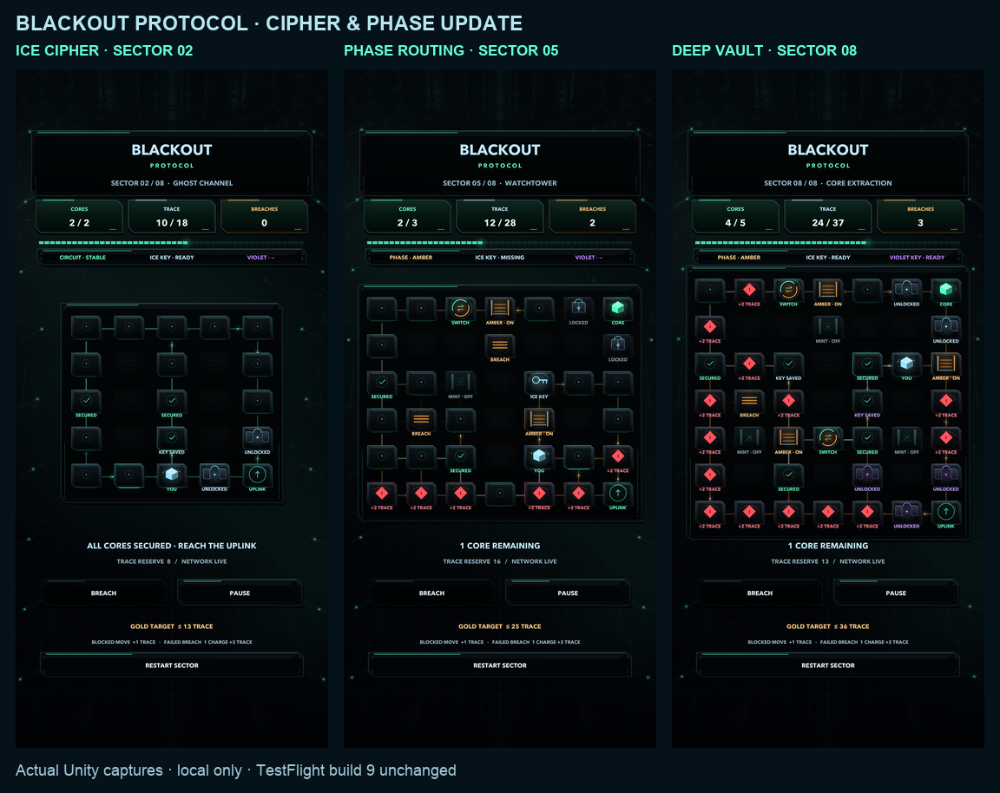

# Blackout Protocol — local cipher and phase update

This updates the local Blackout experiment after the owner asked for more complex puzzles and cooler graphics while keeping its established look. It is newer than the existing TestFlight **1.0.0 (9)**. The owner subsequently authorized committing and pushing the completed source to the existing `codex/neon-visual-update` branch. No device build was exported or uploaded; App Store Connect and the public submission hold are unchanged. `LOCAL_RECORD.json` captures the source and validation state immediately before committing; Git history and `artifacts/blackout-complexity-20261012/git-push-verification.json` record publication separately.

## Gameplay

Ice keys open ice cipher locks; violet keys open violet locks. Clearance persists for the session, so a key can open multiple matching locks. Neither collecting a key nor entering an unlocked lock adds a hidden cost: each is a normal one-trace move. A missing key cannot be bypassed with a breach charge.

Entering a switch exchanges the mint and amber circuits at normal movement cost. Mint gates operate on the mint circuit and amber gates on the amber circuit. Returning to a switch changes the circuit again, so deeper puzzles require planning a route out as well as a route in. Security nodes still cost two trace; firewalls retain the separate one-charge/three-trace breach action.

Mistakes are costly. Attempting to move into an adjacent wall, inactive gate or closed cipher lock spends one trace without moving. Attempting to breach something that is not an available firewall spends one charge, if available, and three trace without opening it. An attempt with no charges still costs three trace and never creates negative charges. Reaching the last trace before extraction immediately fails the run; a legal extraction on that last trace succeeds. A failure offers Retry Sector, which resets trace, keys, opened doors, phase and charges. Pause, duplicate animation-time touches, out-of-board/nonadjacent input and menu navigation do not spend resources. Selecting a firewall is a planning action; its separate Breach button executes the paid action. Node labels, telemetry and the compact cost rail show these rules before acting.

The first sector remains an accessible core-recovery introduction. Sector two introduces keys, sector four introduces phase routing, sector five combines them, and the final two require both cipher keys and repeated phase changes. The eight authored minimum winning costs rise strictly, while spare trace never increases:

| Sector | Name | Minimum trace | Budget | Cores | Grid |
| --- | --- | ---: | ---: | ---: | --- |
| 01 | Packet Recovery | 7 | 13 | 2 | 5 × 4 |
| 02 | Ghost Channel | 12 | 18 | 2 | 5 × 5 |
| 03 | Firewall Fork | 21 | 26 | 3 | 6 × 5 |
| 04 | Split Horizon | 22 | 27 | 3 | 6 × 6 |
| 05 | Watchtower | 24 | 28 | 3 | 7 × 6 |
| 06 | Cipher Vault | 31 | 34 | 4 | 7 × 7 |
| 07 | Dark Weave | 32 | 35 | 5 | 7 × 7 |
| 08 | Core Extraction | 35 | 37 | 5 | 7 × 7 |

Independent Python Dijkstra results are retained in `artifacts/blackout-complexity-20261012/authored-solutions.json`. A separate C# search replays solutions through the actual session model in Unity. Sector four permits a longer route without switching, but a gold route uses the new mechanic. The later sectors need phase routing to finish within budget; sectors seven and eight cannot complete with a frozen mint circuit or either cipher key removed. Numerical route progression is verified; human difficulty still needs playtesting.

## Presentation

The existing obsidian chamber, mint core and Home/extraction design are retained. Puzzle nodes now have layered glass faces, brushed facets, sharper hardware depth, orbiting core glints, holographic key glyphs and opening cipher shutters. Phase gates have distinct powered/offline treatments; moving circuit signals switch between mint and amber. A console emits a travelling energy ring when it exchanges circuits. Compact telemetry shows the current phase and which keys are ready. Symbols and text identify each system alongside its colour.

Node controls remain cached throughout a turn. Pause freezes motion and turns, Reduced Motion settles effects, and navigation cancels pending actions. No image, audio, external font, shader package or dependency was added. The shared tested camera/interface width and original Endless gameplay source are preserved.

## Saves and release boundary

Changed layouts use `blackout.cipher.sector.*` identifiers and separate `skypulse.blackout-campaign.v2` progress. The previous local eight-sector v1 medals and build 9's original four-puzzle medals remain untouched; earned medals are not reassigned to different puzzles. The mistake-penalty rules apply only to the new campaign; build 9's retained puzzle definitions keep their historical behavior. Wallet, bird collection and Endless high score are preserved.

Open `mobile/` in Unity **6000.6.0f1**, open `Assets/Scenes/SkyPulse.unity`, press Play and select Blackout from the mode badge. Clear sectors in order to try the new systems. The project configuration still retains build number 9 as a historical configuration; do not export this modified source as build 9. A future device candidate requires a new unused build number and phone testing. Nothing has been submitted to Apple.

See [test results](TEST_RESULTS.md), [provenance](PROVENANCE.md) and `LOCAL_RECORD.json`. Captures at `artifacts/blackout-complexity-20261012/` come from a disposable Unity QA identity with advanced sectors unlocked for preview; they are not iPhone footage or device performance measurements.

The animated version is retained locally at `artifacts/blackout-complexity-20261012/previews/blackout-complexity-animated.gif`. The tracked still above shows the ice cipher, combined phase vault and deepest dual-key network. A captured run with one blocked move and one failed breach exhausts trace on an otherwise winning Sector 08 route; its failure/retry screen is retained in the local captures.
