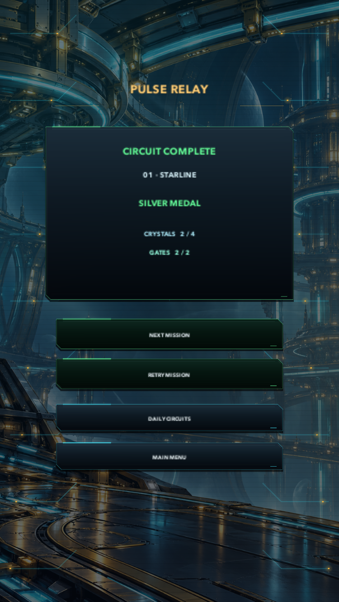
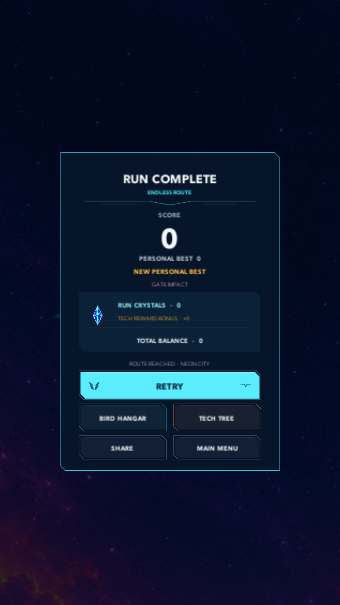

# SkyPulse daily routes and result navigation — build 11

Owner feedback on TestFlight build 10 requested daily refreshed Relay missions, wider Endless pipe spacing, slightly smaller openings, direct next-mission navigation, Main Menu on every mode's result, and cleaner gameplay text. This is the follow-up candidate, **1.0.0 (11)**. The build 10 record remains historical.

## Behaviour

- Four seeded Relay circuits refresh each UTC day. They are stable during that day across launches, with distinct daily titles, bounded heights/approaches and the same two-to-five gate progression. The four-gate circuit still contains eight premium spectral crystals. All daily circuits are free to play.
- Current-day medals use the new `skypulse.relay-daily.v1` namespace; old static-circuit medals are retained unchanged. The wallet and daily-task reward journal are unchanged. Clock rollback does not reopen a completed day. A run crossing midnight retains its original course; completing it records the old run without marking a different day's circuit clear.
- Successful Relay results offer **NEXT MISSION** until the fourth circuit, then stop at the correct daily end. Retry and Daily Circuits remain available; every mode's result has **MAIN MENU**, returning to that mode's Home.
- Owner-authorized Endless tuning: gate spacing increased from **5.265 to 5.589 world units** (+6.15%). Openings are **0.18 world units shorter** at every difficulty tier. Other handling, drift, speed, world width, score, catalogue and economy behaviour is retained. The preservation tool explicitly allows only these tuning deltas.
- Repeated static gameplay instructions and the Endless coach overlay are removed. Needed objectives, live counters, numbered gate ownership, threat/trace feedback and short success/error effects remain. Home's field guides explain controls.

## Verification and publication

`QA_RECORD.json` contains the exact source hashes and required pass markers. `TEST_RESULTS.md` separates Editor checks from physical checks. `RELEASE_RECORD.json` is written after native archive validation and TestFlight publication. Private TestFlight is authorized; public App Review remains on hold, with the build 9 draft retained. Future public listing copy is prepared locally in `metadata.json`.

## Tested result navigation

Rendered from the actual runtime in an isolated QA save; not physical-device screenshots.

