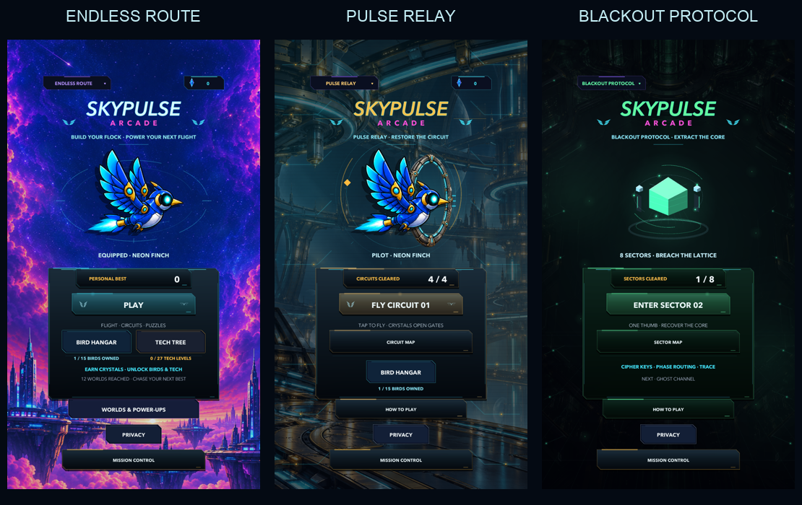
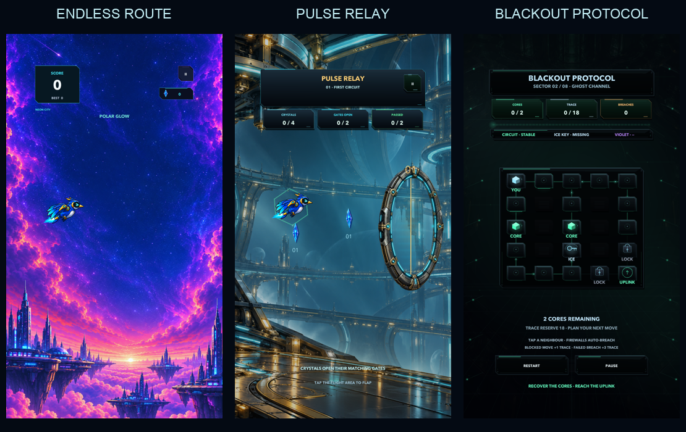
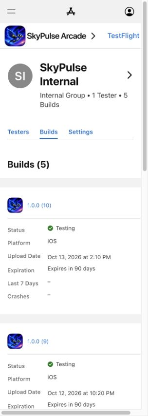

# SkyPulse mobile controls and gameplay polish — 13 October 2026

Published for private testing: **1.0.0 (10), Testing in SkyPulse Internal**. Build-specific notes were saved and verified after reload. Build 9 cannot be replaced on TestFlight. Public App Review remains on hold pending Apple's reply and renewed owner authorization.

## Controls and modes

- Endless Route retains its original input, physics, world width, gate spacing, saves and economy.
- Pulse Relay: tap the flight area to flap. Interactive UI, menus and pause never flap. One press is accepted per deliberate touch; simulated mouse events and held touches cannot duplicate it. Crystals have numbered gate ownership and open their matching gate immediately, before swept collision and course resolution. Each gate spends one charge once; spare crystals improve medals without opening another gate. Retry resets all gates and charges. Four approach routes are gentler and pickups use swept, generous tolerance.
- Relay art reuses the existing faceted spectral crystal, refracted depth and moving facet highlights. Detailed metal portal hardware has a corridor matching its visible aperture, living emitters, soft illumination and a short shutter-opening effect. The logical gate is open throughout that effect. Crystal count, open gates and passed gates are separate HUD instruments.
- Blackout: tap adjacent nodes on pointer down; closed firewalls auto-breach for one charge and three trace, then a second tap enters. Wrong adjacent moves still cost one trace and failed breaches cost three; trace exhaustion can lose the sector. Keys, phase switches, traps, eight increasingly demanding layouts and completion medals retain their existing rules. Only Restart and Pause remain as secondary gameplay controls.
- Blackout movement follows immediately with a 0.12-second smooth transport effect. Success saves and starts the next sector synchronously. A short toast overlays the already-playable next sector. Generation tokens and a held-pointer/completion-frame fence reject stale events. Only the final sector shows campaign completion. Save failure shows an explicit result rather than exposing unsaved progression.
- Home starts on Endless. The badge expands the free-mode list. Alternate Home Play launches the next incomplete circuit/sector directly; maps permit replay. Blackout has no Bird Hangar, Tech Tree or flight-world guide. Relay retains cosmetic Hangar but no Tech Tree. Each Home shows its own progress and guide.

## Verification

See [TEST_RESULTS.md](TEST_RESULTS.md) for automated and remaining physical checks. Test harnesses live under `mobile/Tools`, outside production Assets. The QA runner creates a separate project and separate player-save namespace. Original Endless preservation is checked against baseline `026e382`; 27 method bodies, seven integration hooks and all protected constants are unchanged.

Source and signing evidence are kept in ignored local `artifacts/one-thumb-polish-20261013/`. TestFlight publication status is recorded after upload in `RELEASE_RECORD.json`. Current public listing/build selection is retained while review is on hold. `metadata.json` is a prepared future listing, not a claim it has been saved publicly.

## Actual Unity previews

These are rendered from the tested runtime in an isolated QA save, not proposed artwork or physical screenshots.

## TestFlight publication

Apple processed the signed upload. The existing one-person internal group shows **Testing**. No tester access was expanded; public App Review was not submitted. Open TestFlight on iPhone and update SkyPulse Arcade to 1.0.0 (10). Physical gameplay checks remain separately recorded in `TEST_RESULTS.md` and `RELEASE_RECORD.json`.

